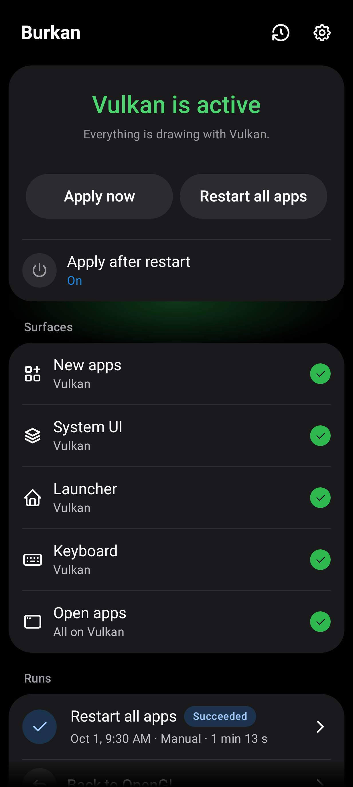
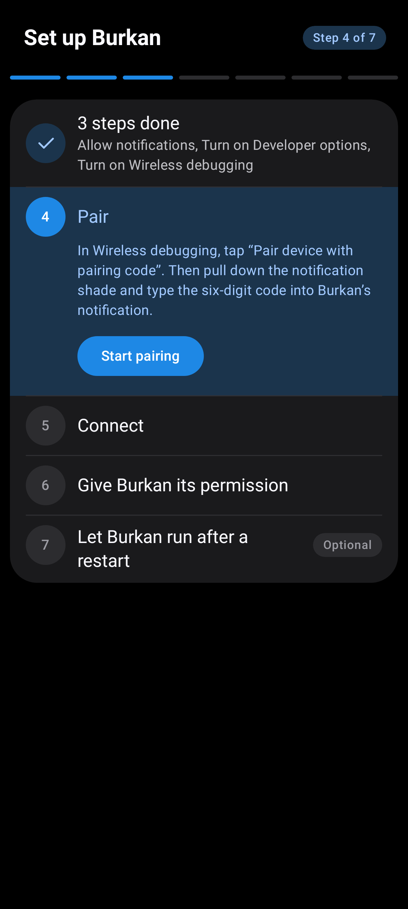
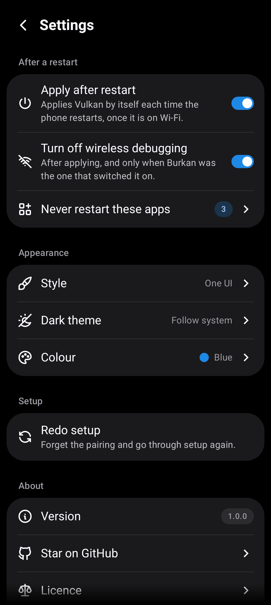
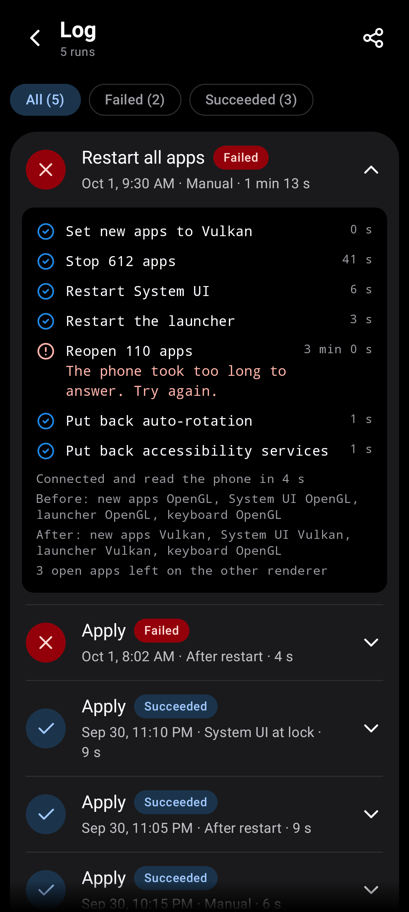
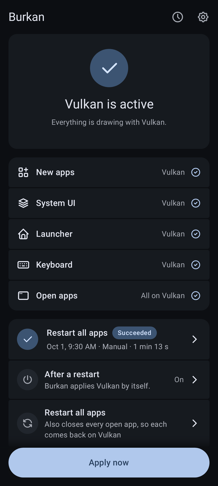
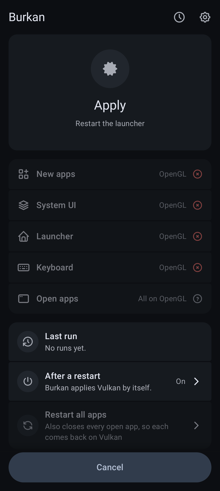
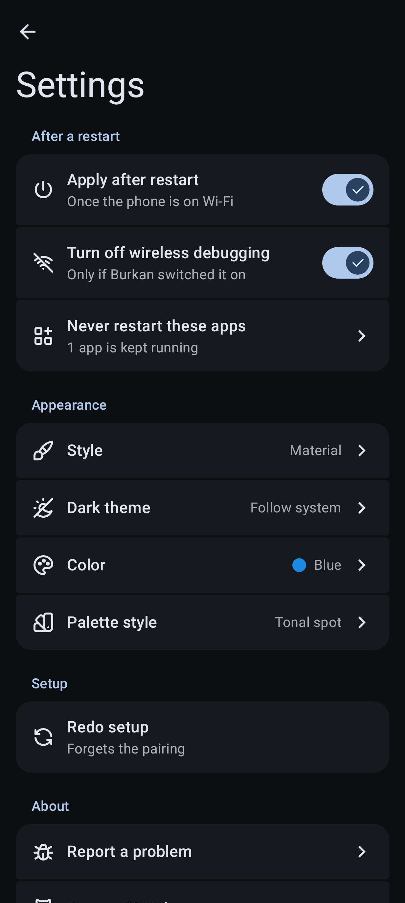
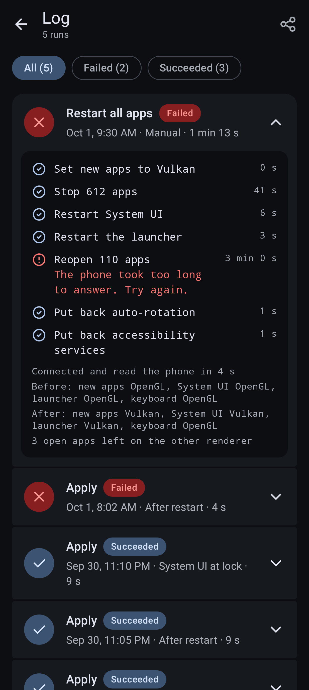

<div align="center">


# Burkan

### Keeps the Vulkan renderer on across restarts on a Samsung Galaxy S23, with no computer and no root.

<br/>

[](https://github.com/barq-al-layl/Burkan/releases/latest)
[](https://www.android.com)
[](https://news.samsung.com/global/galaxy-s23-series)
[](LICENSE)
[](#safe-by-design)

<br/>

[**Download**](#download) · [**Screenshots**](#screenshots) · [**Features**](#features) · [**Quick setup**](#quick-setup) · [**Safe by design**](#safe-by-design) · [**For developers**](#for-developers) · [**FAQ**](#faq)

</div>

## Overview

Galaxy S23 owners widely report that switching Android's UI renderer from OpenGL to Vulkan (`skiavk`) gives smoother animations, less thermal throttling and better battery life. Burkan does not measure any of that itself; it applies the renderer and checks that it took. Android resets the setting on every reboot, and only the privileged shell user can change it.

Until now that meant plugging the phone into a computer after every restart, or keeping a third-party terminal set up on it.

Burkan does it on the phone. It pairs once with the phone's own Wireless Debugging, then connects to it locally (loopback `127.0.0.1` first, the phone's own Wi-Fi address if that fails) and turns Vulkan back on after each restart, without a computer and without asking you.

## Screenshots

<div align="center">

### One UI *(default on Samsung)*
<p align="center">
  
  
  
  
</p>

### Material 3 Expressive
<p align="center">
  
  
  
  
</p>

</div>

## Features

### After a restart
- Applies Vulkan again once the phone is on Wi-Fi, with nothing to tap.
- Restarts System UI at the next screen lock, so the phone never locks in front of you.
- Turns Wireless Debugging back off afterwards, if Burkan was the one that turned it on.
- If the phone restarts without Wi-Fi, Burkan waits and applies as soon as a trusted network connects. It keeps the phone awake only for the short time a run takes.

### By hand
- *Apply now* sets the system property and restarts System UI, the launcher and the keyboard on Vulkan.
- *Restart all apps* closes and relaunches background apps and home screen widgets so they pick up Vulkan. It can restart every app, or only the 30 or 70 most recently used.
- The open apps check lists the apps that were already open and are still on OpenGL, with their icons. Restart them all, restart one, or keep one from ever being restarted.
- *Back to OpenGL* undoes Vulkan at any time, without restarting the phone.
- Exclusions keep chosen apps, such as a media player or a banking app, from ever being restarted.

### Status and logs
- The status check shows whether Vulkan is actually active for new apps, System UI, the home launcher and Samsung Keyboard.
- A step-by-step progress line during a run, and an on-device log of the last 50 runs: how long each step took, what each surface ran on before and after, and a failed command's own error. You can share it as a file that names none of your apps.
- When a connection or system step fails, the app says why in plain language.

### Automation
- A Quick Settings tile shows whether Vulkan has been applied since the last restart; tap it to apply.
- *Apply now* and *Restart all apps* are app shortcuts on a long press of the icon.
- Tasker and routines can start a run with a broadcast and hear how it ended. [`docs/architecture.md`](docs/architecture.md) lists the actions.
- A notification says when the apply after a restart has finished, and offers to restart open apps still on OpenGL.

### Setup
- Each step opens Settings scrolled to the row to change, with the row highlighted.
- You enter the pairing code from a notification, without leaving Settings.
- If Burkan crashes, it keeps a readable report you can share. Nothing is sent anywhere on its own.

### Two designs
- A One UI style that follows Samsung's own system apps.
- Material 3 Expressive, with dynamic colour from MaterialKolor.
- Dark and light modes, with a circular reveal when the theme changes.

## Download

| Source | Channel | Status |
| :--- | :--- | :--- |
| [**GitHub Releases**](https://github.com/barq-al-layl/Burkan/releases/latest) | APK (Direct Download) | Stable (`v1.1.0`) |
| [**F-Droid**](docs/f-droid.md) | F-Droid Repository | Submitted, in review |
| [**Obtainium**](https://github.com/ImranR98/Obtainium) | Add Repo URL | Auto-update supported |

## Quick setup

> [!NOTE]
> You need a Samsung Galaxy S23, S23+, or S23 Ultra on Android 13 or newer, connected to Wi-Fi. Tested on One UI 8.5 (Android 16).

Setup takes under two minutes and is done once.

1. Download the APK from [Releases](https://github.com/barq-al-layl/Burkan/releases/latest) and install it.
2. Follow the guide. Burkan walks you through allowing notifications and turning on *Developer options* and *Wireless debugging*, one step at a time.
3. Tap *Pair device with pairing code* in Developer options, pull down the notification shade, and type the 6-digit code into Burkan's prompt there.
4. Burkan then grants itself the secure settings permission and asks to be exempt from battery optimization, so runs after a restart are not cut short. From then on it applies Vulkan after each restart.

## Safe by design

- Burkan never connects to the internet. It declares `android.permission.INTERNET` only to reach the phone's own `adbd` daemon. The one thing it sends on your Wi-Fi network is Android's standard local service discovery (mDNS), to find the Wireless Debugging port. It has no analytics, no crash uploader and no ads.
- It does not unlock the bootloader or modify system partitions, so the Knox warranty bit stays at `0x0`.
- The ADB pairing key (2048-bit RSA) is stored on the phone with Android Keystore through KSafe, and is excluded from cloud backups and device-to-device transfers.
- Android resets `debug.hwui.renderer` to OpenGL on every normal reboot. To go back at once, tap *Back to OpenGL* on the Home screen; to stay on OpenGL, also turn off *Apply after restart* in Burkan's Settings.

## For developers

The code is laid out like this:

```
io.github.barqallayl.burkan
├── core/
│   ├── di/          Metro dependency injection graph (@DependencyGraph)
│   ├── model/       Domain models and typed AppError hierarchy
│   ├── navigation/  Navigation 3 type-safe routes & transitions
│   ├── shell/       Shell commands, executors & renderer parsing
│   └── storage/     DataStore Preferences for settings & device state
├── designsystem/    BurkanTheme, MaterialKolor seeds, M3 Expressive components
└── feature/
    ├── connection/  On-device ADB client (libadb-android, Conscrypt, SPAKE2) & KSafe key storage
    └── …            MVI features (setup, status, apply, settings, log)
```

### Stack
- UI: Jetpack Compose with Material 3 Expressive components and custom segmented layouts.
- Dependency injection: the [Metro](https://github.com/ZacSweers/metro) compiler plugin, which checks the graph at build time.
- State: [Orbit MVI](https://github.com/orbit-mvi/orbit-mvi) container hosts.
- Navigation: [Navigation 3](https://developer.android.com/guide/navigation) with serializable type-safe keys.
- Errors: [Arrow](https://arrow-kt.io/) `Either<AppError, T>` throughout.
- Screenshot tests: every Compose preview is also a [Roborazzi](https://github.com/takahirom/roborazzi) screenshot test, run on Robolectric.

### Building and checking

Requires JDK 25 and Android SDK Platform 37.

```bash
# Compile debug APK
./gradlew :app:assembleDebug

# Run unit tests and Orbit container tests
./gradlew :app:testDebugUnitTest

# Verify UI screenshot baselines with Roborazzi
./gradlew :app:verifyRoborazziDebug

# Assemble release APK
./gradlew :app:assembleRelease
```

More detail is in:
- [`docs/architecture.md`](docs/architecture.md): how the app is put together, its state flows and its services.
- [`docs/device-notes.md`](docs/device-notes.md): the exact shell commands, and timings measured on a real S23.
- [`docs/testing.md`](docs/testing.md): what has been tested on a phone and what has not.
- [`CONTRIBUTING.md`](CONTRIBUTING.md): code style, pull request rules and testing.

## FAQ

<details>
<summary><b>Does this work on devices other than the Galaxy S23 series?</b></summary>
<br>
Burkan was built for the Snapdragon 8 Gen 2 for Galaxy and verified on the Galaxy S23 (SM-S911) and S23 Ultra (SM-S918). The S23+ (SM-S916) has the same platform and is treated as supported. Burkan opens on other phones with a warning, but how stable the Vulkan renderer is varies a lot between chips and manufacturers' Android versions.
</details>

<details>
<summary><b>Why does Burkan need Wi-Fi?</b></summary>
<br>
Android only runs the Wireless Debugging daemon while the phone is on a Wi-Fi network. Once it is running, Burkan connects to it on the phone itself to run the renderer command. The Wi-Fi network is what lets Android turn the daemon on; the commands never travel over it.
</details>

<details>
<summary><b>How can I check that Vulkan is really active?</b></summary>
<br>
The Home screen shows what each surface renders with, read from <code>dumpsys gfxinfo</code>. You can also check for yourself by turning on <b>GPUWatch</b> in Developer options and opening any app.
</details>

## Acknowledgements

- Inspired by the research and scripts in [s23-vulkan-support](https://github.com/Ameen-Sha-Cheerangan/s23-vulkan-support).
- Uses [libadb-android](https://github.com/MuntashirAkon/libadb-android) for the ADB protocol.

## License

Copyright © 2026 Mohammed Barq AL Layl.

Licensed under the [Apache License, Version 2.0](LICENSE).

Third-party libraries keep their own licenses: `libadb-android` is used under its Apache-2.0 option, and its pairing helper `spake2-java` under the LGPL-3.0. The full list of dependency licenses is in the app under **Settings › Open-source licences**.
